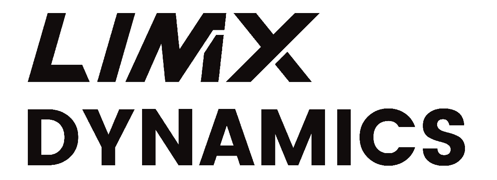

<div align="center">

<a href="README.md"></a>&nbsp;&nbsp;<a href="README_cn.md"></a>

</div>

<p align="center">
  <picture>
    <source media="(prefers-color-scheme: dark)" srcset="doc/logo-white-theme.png">
    <source media="(prefers-color-scheme: light)" srcset="doc/logo-black-theme.png">
    
  </picture>
</p>

LimX Dynamics（逐际动力）是一家通用机器人公司，专注于全尺寸人形机器人，并已研发出双足、四足等系列创新产品。

LimX Dynamics 致力于以具身智能（Embodied AI）驱动颠覆式创新。我们的目标是让通用人工智能（AGI）的泛化能力在物理世界充分释放。基于革命性的核心软硬件技术，并为人形机器人构建首创的基础模型（foundation model），我们希望为创新者与集成商提供移动操作（loco-manipulation）机器人平台与具身智能工具集，推动具身智能在 B2B 与 B2C 领域（包括研发、制造、商务与家庭服务）的广泛应用。

<div align="center">
<p align="center">
  <a href="https://www.youtube.com/@LimXDynamics/featured"></a>&nbsp;
  <a href="https://space.bilibili.com/1172054289"></a>&nbsp;
  <a href="https://www.douyin.com/user/MS4wLjABAAAAi4WtqIxdAP5iqbT4BSEgUWPu6g9h_Pl7VXaQOLfDeFK1LgZo5O4IbIknTVeL6Zq-?from_tab_name=main&relation=0&vid=7654443992867786011"></a>&nbsp;
  <a href="https://www.xiaohongshu.com/user/profile/66e44fa8000000001d020784?xsec_token=ABnTSjc077y0Y9d7LrDkVdpR_IwBO36Dm_4eHTx1mXBE0=&xsec_source=pc_note"></a>&nbsp;
  <a href="https://www.kuaishou.com/profile/3xvskq6dkc4puq6"></a>&nbsp;
  <a href="https://x.com/LimX_Dynamics"></a>&nbsp;
  <a href="https://github.com/limxdynamics/limxdynamics/blob/main/doc/wechat_official_cn.png"></a>
</p>

<p align="center">
  <a href="https://huggingface.co/limxdynamics"></a>&nbsp;
  <a href="https://modelscope.cn/organization/LimXDynamics?tab=all"></a>&nbsp;
  <a href="https://www.limxdynamics.com/"></a>&nbsp;
  <a href="https://career.limxdynamics.com/"></a>
</p>

<p align="center">
  <a href="https://github.com/limxdynamics"></a>&nbsp;
  <a href="https://github.com/limxdynamics"></a>&nbsp;
  <a href="https://github.com/limxdynamics"></a>
</p>
</div>


<p align="center">
  <picture>
    <source media="(prefers-color-scheme: dark)" srcset="https://raw.githubusercontent.com/limxdynamics/limxdynamics/main/stars-dark.svg?v=202610260609">
    <source media="(prefers-color-scheme: light)" srcset="https://raw.githubusercontent.com/limxdynamics/limxdynamics/main/stars.svg?v=202610260609">
    
  </picture>
</p>

## 快速上手

LimX 各条技术栈都是同一个结构：**MuJoCo 仿真器**和 **RL 控制器**是两个进程，通过 LimX SDK（[limxsdk-lowlevel](https://github.com/limxdynamics/limxsdk-lowlevel)）在 `127.0.0.1` 上通信；把这个地址换成机器人 IP 就是真机部署。所以最快的入门方式，就是先在仿真里看一个训练好的策略走起来——不需要机器人，也不需要 GPU。

### 1. 在仿真里让机器人走起来（约 10 分钟）

以下为 TRON1 + Linux x86_64，Python 3.10–3.12。

```bash
git clone --recurse-submodules https://github.com/limxdynamics/tron1-mujoco-sim
git clone https://github.com/limxdynamics/tron1-rl-deploy-python

python3 -m venv ~/.venvs/limx-tron1 && source ~/.venvs/limx-tron1/bin/activate
# SDK wheel 会一并装上 mujoco、onnxruntime、scipy、pyyaml、pygame
pip install tron1-mujoco-sim/limxsdk-lowlevel/python3/amd64/limxsdk-*-py3-none-any.whl
```

```bash
# 终端 1 —— 仿真器
source ~/.venvs/limx-tron1/bin/activate
export ROBOT_TYPE=PF_TRON1A        # PF_* 点足，SF_* 双足（足底），WF_* 轮足
python tron1-mujoco-sim/simulator.py

# 终端 2 —— RL 控制器（仓库自带训练好的 ONNX 策略）
source ~/.venvs/limx-tron1/bin/activate
export ROBOT_TYPE=PF_TRON1A RL_TYPE=isaaclab
python tron1-rl-deploy-python/main.py
```

> 仿真器一启动机器人就会倒地。等控制器跑起来后，在 MuJoCo 窗口按 **Backspace**，机器人就会站起来原地踏步。运行 `./tron1-mujoco-sim/robot-joystick/robot-joystick` 可以用虚拟手柄操控它。

### 2. 下一步

| 我想… | 从这里开始 |
|---|---|
| 训练自己的运动策略（Isaac Lab，需 NVIDIA GPU） | TRON1：[tron1-rl-isaaclab](https://github.com/limxdynamics/tron1-rl-isaaclab)，任务 `Isaac-Limx-{PF,SF,WF}-Blind-Flat-v0`<br>TRON2：[tron2_rl_lab](https://github.com/limxdynamics/tron2_rl_lab)，任务 `Isaac-Limx-{SF,WF,DASF}-TRON2A-Blind-Flat-v0`<br>Oli：[humanoid-rl-isaaclab](https://github.com/limxdynamics/humanoid-rl-isaaclab) |
| 在真机上跑策略 | 用上面同一个控制器，指向机器人：`python main.py <robot-ip>`。先把机器人吊起来，并阅读对应仓库的安全说明。 |
| 在 ROS / ROS 2 里部署 | 下表中的 `*-rl-deploy-ros` / `*-rl-deploy-ros2`，以及 [ros1-bridger](https://github.com/limxdynamics/ros1-bridger) / [ros2-bridger](https://github.com/limxdynamics/ros2-bridger) |
| 写自己的控制器 | [limxsdk-lowlevel](https://github.com/limxdynamics/limxsdk-lowlevel) 里的 SDK 示例（C++ 和 Python） |
| 在 TRON2 上做操作 / VLA | [tron2_manipulation_controller](https://github.com/limxdynamics/tron2_manipulation_controller)（仿真 + SDK）、[tron2_openpi](https://github.com/limxdynamics/tron2_openpi) + [tron2_env](https://github.com/limxdynamics/tron2_env)（真机运行 pi0/pi0.5）、[FluxVLA](https://github.com/FluxVLA/FluxVLA) |
| 看一个完整的视觉抓取 demo 跑起来 | [tron2_visual_grasp](https://github.com/limxdynamics/tron2_visual_grasp)：TRON2 的网球抓取闭环（发现 → 驶近 → 下蹲 → 抓取），纯 OpenCV、纯 CPU，无硬件也能跑（`./run.sh demo`） |
| 把人体动作重定向到人形机器人 | [GMR](https://github.com/limxdynamics/GMR) → [luna-beyondmimic](https://github.com/limxdynamics/luna-beyondmimic) |
| 不写代码，只关注行业动态 | [embodied-ai-insights](https://github.com/limxdynamics/embodied-ai-insights) 月度报告 |

## 开源项目

<p align="center"><a href="https://github.com/limxdynamics/limxdynamics/blob/main/doc/wechat_qr.png"></a></p>

<table class="table table-striped table-bordered table-vcenter"/>
    <tbody>
    <tr><th>平台</th><th>类型</th><th> 项目 </th> <th>描述</th> <th>Stars</th> </tr>
    <!-- 空的占位行用于让跨行分类单元格保持默认的白色条纹。 -->
    <tr></tr>
    <tr>
        <td rowspan="1" class="font-weight-bold">行业洞察</td>
        <td align="center" >月报</td>
        <td align="center" ><a href="https://github.com/limxdynamics/embodied-ai-insights"> embodied-ai-insights </a></td>
        <td> 基于 GitHub 公开数据的具身智能开源生态观察——逐月追踪各家机器人企业的 star 增长、新仓发布与社区活跃度，输出月报与专题分析。 </td>
        <td><a href="https://github.com/limxdynamics/embodied-ai-insights"></a></td>
    </tr>
    <tr></tr>
    <tr>
        <td rowspan="14" class="font-weight-bold">TRON2</td>
        <td align="center" >描述</td>
        <td align="center" ><a href="https://github.com/limxdynamics/tron2-robot-description"> tron2-robot-description </a></td>
        <td> TRON2 各型号的机器人模型文件，包括 URDF/xacro、MuJoCo XML、网格（mesh）以及可选的 USD 资源，用于仿真、可视化与下游工具。 </td>
        <td><a href="https://github.com/limxdynamics/tron2-robot-description"></a></td>
    </tr>
    <tr>
        <td align="center" >仿真</td>
        <td align="center" ><a href="https://github.com/limxdynamics/tron2_gazebo_ros"> tron2_gazebo_ros </a></td>
        <td> 面向 TRON2 机器人的 ROS Noetic 与 Gazebo 仿真工作区，支持控制器集成、Sim-to-Real 验证与部署流程。 </td>
        <td><a href="https://github.com/limxdynamics/tron2_gazebo_ros"></a></td>
    </tr>
    <tr>
        <td align="center" >仿真</td>
        <td align="center" ><a href="https://github.com/limxdynamics/tron2_mujoco_sim"> tron2_mujoco_sim </a></td>
        <td> 面向 TRON2 机器人的 <a href="https://mujoco.org"> MuJoCo </a> 仿真工具，支持 SF/WF 机型，并通过 LimX SDK 完成控制器部署。 </td>
        <td><a href="https://github.com/limxdynamics/tron2_mujoco_sim"></a></td>
    </tr>
    <tr>
        <td align="center" >训练</td>
        <td align="center" ><a href="https://github.com/limxdynamics/tron2_rl_lab"> tron2_rl_lab </a></td>
        <td> 基于 <a href="https://isaac-sim.github.io/IsaacLab/"> Isaac Lab </a> 的 TRON2 强化学习训练栈，支持 SF/WF（脚式/轮式）变体。 </td>
        <td><a href="https://github.com/limxdynamics/tron2_rl_lab"></a></td>
    </tr>
    <tr>
        <td align="center" >训练</td>
        <td align="center" ><a href="https://github.com/limxdynamics/TRON2_YG_LAB"> TRON2_YG_LAB </a></td>
        <td> 面向 TRON2 的 Isaac Lab 强化学习训练栈，支持 6 自由度机械臂与夹爪变体，用于运动策略训练与演示。 </td>
        <td><a href="https://github.com/limxdynamics/TRON2_YG_LAB"></a></td>
    </tr>
    <tr>
        <td align="center" >部署</td>
        <td align="center" ><a href="https://github.com/limxdynamics/tron2_rl_deploy_python"> tron2_rl_deploy_python </a></td>
        <td> 面向 TRON2 的 Python 强化学习部署演示，可运行 ONNX 策略，并支持 MuJoCo 仿真与真机部署。 </td>
        <td><a href="https://github.com/limxdynamics/tron2_rl_deploy_python"></a></td>
    </tr>
    <tr>
        <td align="center" >部署</td>
        <td align="center" ><a href="https://github.com/limxdynamics/tron2_rl_deploy_ros"> tron2_rl_deploy_ros </a></td>
        <td> 面向 TRON2 的 ROS Noetic 强化学习部署工作区，包含仿真与真机所需的硬件、控制器与 ONNX 运行时软件包。 </td>
        <td><a href="https://github.com/limxdynamics/tron2_rl_deploy_ros"></a></td>
    </tr>
    <tr>
        <td align="center" >部署</td>
        <td align="center" ><a href="https://github.com/limxdynamics/tron2_env"> tron2_env </a></td>
        <td> 面向 OpenPI 部署的公开 TRON2 运行时软件包，提供 WebSocket 机器人通信、动作执行、观测采集以及真机操作所需的 RTC 工具。 </td>
        <td><a href="https://github.com/limxdynamics/tron2_env"></a></td>
    </tr>
    <tr>
        <td align="center" >部署</td>
        <td align="center" ><a href="https://github.com/limxdynamics/tron2_openpi"> tron2_openpi </a></td>
        <td> 基于 OpenPI 衍生的 TRON2 部署版，新增 TRON2 策略变换、部署配置模板、pi0/pi0.5 策略服务与真机客户端示例。 </td>
        <td><a href="https://github.com/limxdynamics/tron2_openpi"></a></td>
    </tr>
    <tr>
        <td align="center" >操作</td>
        <td align="center" ><a href="https://github.com/limxdynamics/tron2_manipulation_controller"> tron2_manipulation_controller </a></td>
        <td> TRON2 双臂机器人的本地仿真与 SDK 验证工作区：在一台机器上拉起 <a href="https://mujoco.org"> MuJoCo </a> 电机级仿真器、控制器运行包与 WebSocket SDK，并支持 VLA 轨迹回放与限位校验。 </td>
        <td><a href="https://github.com/limxdynamics/tron2_manipulation_controller"></a></td>
    </tr>
    <tr>
        <td align="center" >操作</td>
        <td align="center" ><a href="https://github.com/limxdynamics/tron2_visual_grasp"> tron2_visual_grasp </a></td>
        <td> 面向 TRON2 机器人的视觉引导移动抓取演示：用纯 OpenCV 找到网球，自行驶近、下蹲，并用腕部 RealSense D405 完成抓取，全程运行在 CPU 上，无需 GPU 与神经网络。 </td>
        <td><a href="https://github.com/limxdynamics/tron2_visual_grasp"></a></td>
    </tr>
    <tr>
        <td align="center" >导航</td>
        <td align="center" ><a href="https://github.com/limxdynamics/tron2-navigation-ros2"> tron2-navigation-ros2 </a></td>
        <td> 面向 TRON2 的 ROS 2 Humble 导航集成，包含生产级 SCAN-Planner 子集、RoboSense 激光雷达驱动与安全/部署工具；GPL 组件位于配套仓库中。 </td>
        <td><a href="https://github.com/limxdynamics/tron2-navigation-ros2"></a></td>
    </tr>
    <tr>
        <td align="center" >导航</td>
        <td align="center" ><a href="https://github.com/limxdynamics/tron2-navigation-pct-gpl"> tron2-navigation-pct-gpl </a></td>
        <td> tron2-navigation-ros2 的 PCT 规划器源码（GPL-2.0-or-later）。 </td>
        <td><a href="https://github.com/limxdynamics/tron2-navigation-pct-gpl"></a></td>
    </tr>
    <tr>
        <td align="center" >导航</td>
        <td align="center" ><a href="https://github.com/limxdynamics/tron2-navigation-fastlio-gpl"> tron2-navigation-fastlio-gpl </a></td>
        <td> tron2-navigation-ros2 的 FAST-LIO ROS 2 源码（GPL-2.0-only）。 </td>
        <td><a href="https://github.com/limxdynamics/tron2-navigation-fastlio-gpl"></a></td>
    </tr>
    <tr></tr>
    <tr>
        <td rowspan="7" class="font-weight-bold">Oli</td>
        <td align="center" >描述</td>
        <td align="center" ><a href="https://github.com/limxdynamics/humanoid-description"> humanoid-description </a></td>
        <td> 机器人模型文件，包括 URDF、USD 与 XML 模型文件，可用于仿真、训练等。 </td>
        <td><a href="https://github.com/limxdynamics/humanoid-description"></a></td>
    </tr>
    <tr>
        <td align="center" >仿真</td>
        <td align="center" ><a href="https://github.com/limxdynamics/humanoid-mujoco-sim"> humanoid-mujoco-sim </a></td>
        <td> 面向 Oli 机器人的 <a href="https://mujoco.org"> MuJoCo </a> 仿真工具，支持快速的 Sim-to-Real 验证与机器人算法部署。 </td>
        <td><a href="https://github.com/limxdynamics/humanoid-mujoco-sim"></a></td>
    </tr>
    <tr>
        <td align="center" >训练</td>
        <td align="center" ><a href="https://github.com/limxdynamics/humanoid-rl-isaaclab"> humanoid-rl-isaaclab </a></td>
        <td> 基于 <a href="https://isaac-sim.github.io/IsaacLab/"> Isaac Lab </a> 专为 Oli 人形机器人设计的强化学习训练框架，提供完整的仿真与训练工具，并支持 Sim-to-Real 运动部署。 </td>
        <td><a href="https://github.com/limxdynamics/humanoid-rl-isaaclab"></a></td>
    </tr>
    <tr>
        <td align="center" >部署</td>
        <td align="center" ><a href="https://github.com/limxdynamics/humanoid-rl-deploy-python"> humanoid-rl-deploy-python </a></td>
        <td> 基于 Python 的强化学习部署算法，简化在 Oli 机器人上部署已训练模型的过程。 </td>
        <td><a href="https://github.com/limxdynamics/humanoid-rl-deploy-python"></a></td>
    </tr>
    <tr>
        <td align="center" >部署</td>
        <td align="center" ><a href="https://github.com/limxdynamics/humanoid-rl-deploy-cpp"> humanoid-rl-deploy-cpp </a></td>
        <td> 轻量级 C++ 算法框架，在无需 ROS1/ROS2 时支持快速部署已训练模型。 </td>
        <td><a href="https://github.com/limxdynamics/humanoid-rl-deploy-cpp"></a></td>
    </tr>
    <tr>
        <td align="center" >部署</td>
        <td align="center" ><a href="https://github.com/limxdynamics/humanoid-rl-deploy-ros2"> humanoid-rl-deploy-ros2 </a></td>
        <td> 基于 <a href="https://www.ros.org">ROS2</a> 的强化学习部署框架，支持在 Oli 机器人上快速部署已训练模型。 </td>
        <td><a href="https://github.com/limxdynamics/humanoid-rl-deploy-ros2"></a></td>
    </tr>
    <tr>
        <td align="center" >部署</td>
        <td align="center" ><a href="https://github.com/limxdynamics/humanoid-rl-deploy-ros"> humanoid-rl-deploy-ros </a></td>
        <td> 基于 <a href="https://www.ros.org">ROS1</a> 的强化学习部署框架，支持在 Oli 机器人上快速部署已训练模型。 </td>
        <td><a href="https://github.com/limxdynamics/humanoid-rl-deploy-ros"></a></td>
    </tr>
    <tr></tr>
    <tr>
        <td rowspan="3" class="font-weight-bold">Luna</td>
        <td align="center" >描述</td>
        <td align="center" ><a href="https://github.com/limxdynamics/luna-description"> luna-description </a></td>
        <td> LimX Luna 人形机器人的模型文件 — URDF、MuJoCo MJCF 与 NVIDIA USD（含闭环并联版本），可用于仿真、可视化与下游工具。 </td>
        <td><a href="https://github.com/limxdynamics/luna-description"></a></td>
    </tr>
    <tr>
        <td align="center" >算法</td>
        <td align="center" ><a href="https://github.com/limxdynamics/luna-beyondmimic"> luna-beyondmimic </a></td>
        <td> 基于 BeyondMimic 的全身动作学习框架，教会 LimX Luna 人形机器人跳舞 — 从人类舞蹈动作到可在 Isaac Lab 上部署的策略。 </td>
        <td><a href="https://github.com/limxdynamics/luna-beyondmimic"></a></td>
    </tr>
    <tr>
        <td align="center" >算法</td>
        <td align="center" ><a href="https://github.com/limxdynamics/GMR"> GMR </a></td>
        <td> LimX Dynamics 的 GMR（通用动作重定向）fork — 将人体动作（SMPL-X/BVH/Xsens/OptiTrack）实时重定向到 LimX 人形机器人（OLI EDU、Luna）及 17+ 种其他机器人，可在 CPU 上运行。 </td>
        <td><a href="https://github.com/limxdynamics/GMR"></a></td>
    </tr>
    <tr></tr>
    <tr>
        <td rowspan="12" class="font-weight-bold">TRON1</td>
        <td align="center" >描述</td>
        <td align="center" ><a href="https://github.com/limxdynamics/tron1-robot-description"> tron1-robot-description </a></td>
        <td> TRON1 各型号的机器人模型文件，包括 URDF/xacro、MuJoCo XML 与网格文件，适用于点足与轮腿机器人。 </td>
        <td><a href="https://github.com/limxdynamics/tron1-robot-description"></a></td>
    </tr>
    <tr>
        <td align="center" >仿真</td>
        <td align="center" ><a href="https://github.com/limxdynamics/tron1-gazebo-ros"> tron1-gazebo-ros </a></td>
        <td> 基于 <a href="https://www.ros.org"> ROS1 </a> 的 TRON1 仿真工具，支持快速的 Sim-to-Real 验证与机器人算法部署。 </td>
        <td><a href="https://github.com/limxdynamics/tron1-gazebo-ros"></a></td>
    </tr>
    <tr>
        <td align="center" >仿真</td>
        <td align="center" ><a href="https://github.com/limxdynamics/tron1-gazebo-ros2"> tron1-gazebo-ros2 </a></td>
        <td> 基于 <a href="https://www.ros.org"> ROS2 </a> 的 TRON1 仿真工具，支持快速的 Sim-to-Real 验证与机器人算法部署。 </td>
        <td><a href="https://github.com/limxdynamics/tron1-gazebo-ros2"></a></td>
    </tr>
    <tr>
        <td align="center" >仿真</td>
        <td align="center" ><a href="https://github.com/limxdynamics/tron1-mujoco-sim"> tron1-mujoco-sim </a></td>
        <td> 基于 <a href="https://mujoco.org"> MuJoCo </a> 的 TRON1 仿真工具，支持快速的 Sim-to-Real 验证与机器人算法部署。 </td>
        <td><a href="https://github.com/limxdynamics/tron1-mujoco-sim"></a></td>
    </tr>
    <tr>
        <td align="center" >训练</td>
        <td align="center" ><a href="https://github.com/limxdynamics/tron1-rl-isaaclab"> tron1-rl-isaaclab </a></td>
        <td> 基于 <a href="https://isaac-sim.github.io/IsaacLab/"> Isaac Lab </a> 专为 TRON1 设计的强化学习训练框架，提供完整的仿真与训练工具，并支持在多种环境中进行强化学习。 </td>
        <td><a href="https://github.com/limxdynamics/tron1-rl-isaaclab"></a></td>
    </tr>
    <tr>
        <td align="center" >训练</td>
        <td align="center" ><a href="https://github.com/limxdynamics/tron1-rl-isaacgym"> tron1-rl-isaacgym </a></td>
        <td> 基于 <a href="https://developer.nvidia.com/isaac-gym"> Isaac Gym </a> 专为 TRON1 设计的强化学习训练框架，提供完整的仿真与训练工具，并支持在多种环境中进行强化学习。 </td>
        <td><a href="https://github.com/limxdynamics/tron1-rl-isaacgym"></a></td>
    </tr>
    <tr>
        <td align="center" >部署</td>
        <td align="center" ><a href="https://github.com/limxdynamics/tron1-rl-deploy-ros"> tron1-rl-deploy-ros </a></td>
        <td> 基于 <a href="https://www.ros.org"> ROS1 </a> 的强化学习部署框架，帮助您快速部署训练好的模型。 </td>
        <td><a href="https://github.com/limxdynamics/tron1-rl-deploy-ros"></a></td>
    </tr>
    <tr>
        <td align="center" >部署</td>
        <td align="center" ><a href="https://github.com/limxdynamics/tron1-rl-deploy-ros2"> tron1-rl-deploy-ros2 </a></td>
        <td> 基于 <a href="https://www.ros.org"> ROS2 </a> 的强化学习部署框架，帮助您快速部署训练好的模型。 </td>
        <td><a href="https://github.com/limxdynamics/tron1-rl-deploy-ros2"></a></td>
    </tr>
    <tr>
        <td align="center" >部署</td>
        <td align="center" ><a href="https://github.com/limxdynamics/tron1-rl-deploy-python"> tron1-rl-deploy-python </a></td>
        <td> 基于 Python 的强化学习部署算法，帮助您简化训练模型的部署流程。 </td>
        <td><a href="https://github.com/limxdynamics/tron1-rl-deploy-python"></a></td>
    </tr>
    <tr>
        <td align="center" >部署</td>
        <td align="center" ><a href="https://github.com/limxdynamics/tron1-rl-deploy-arm"> tron1-rl-deploy-arm </a></td>
        <td> 基于 ONNX runtime 的 TRON1 机械臂控制器强化学习部署框架。 </td>
        <td><a href="https://github.com/limxdynamics/tron1-rl-deploy-arm"></a></td>
    </tr>
    <tr>
        <td align="center" >导航</td>
        <td align="center" ><a href="https://github.com/limxdynamics/tron1-ss"> tron1-ss </a></td>
        <td> 基于 ROS Noetic 的 TRON1 SLAM 与自主导航栈，支持激光雷达建图、定位与路径规划。 </td>
        <td><a href="https://github.com/limxdynamics/tron1-ss"></a></td>
    </tr>
    <tr>
        <td align="center" >智能体</td>
        <td align="center" ><a href="https://github.com/limxdynamics/tron1-agent"> tron1-agent </a></td>
        <td> 面向 Tron 机器人的实时语音交互智能体，具备基于 LLM 的对话、语音识别（FunASR）、TTS、工具调用与任务管理能力。 </td>
        <td><a href="https://github.com/limxdynamics/tron1-agent"></a></td>
    </tr>
    <tr>
        <td rowspan="3" class="font-weight-bold">VLA</td>
        <td align="center" >算法</td>
        <td align="center" ><a href="https://github.com/FluxVLA/FluxVLA"> FluxVLA </a></td>
        <td> 面向具身智能的一体化 VLA 工程平台 — 从数据采集到真机部署。 </td>
        <td><a href="https://github.com/FluxVLA/FluxVLA"></a></td>
    </tr>
    <tr>
        <td align="center" >仿真</td>
        <td align="center" ><a href="https://github.com/FluxVLA/FluxBisim"> FluxBisim </a></td>
        <td> 基于 IsaacSim 的 FluxVLA 双臂操作仿真平台。 </td>
        <td><a href="https://github.com/FluxVLA/FluxBisim"></a></td>
    </tr>
    <tr>
        <td align="center" >算法</td>
        <td align="center" ><a href="https://github.com/FluxVLA/FluxDAgger"> FluxDAgger </a></td>
        <td> 面向双臂操作的模型解耦 DAgger 流水线 — 通过人在回路进行数据采集，兼容任意 VLA 与奖励模型。 </td>
        <td><a href="https://github.com/FluxVLA/FluxDAgger"></a></td>
    </tr>
    <tr></tr>
    <tr>
        <td rowspan="7" class="font-weight-bold">SDK &amp; 工具</td>
        <td align="center" >SDK</td>
        <td align="center" ><a href="https://github.com/limxdynamics/limxsdk-lowlevel"> limxsdk-lowlevel </a></td>
        <td> 用于直接与机器人通信（电机、传感器、实时控制）的低层 SDK，供上述仿真与部署仓库使用。 </td>
        <td><a href="https://github.com/limxdynamics/limxsdk-lowlevel"></a></td>
    </tr>
    <tr>
        <td align="center" >可视化</td>
        <td align="center" ><a href="https://github.com/limxdynamics/robot-visualization"> robot-visualization </a></td>
        <td> 通过 RViz/PlotJuggler 实时可视化机器人关节状态、IMU、力传感器与运动轨迹。 </td>
        <td><a href="https://github.com/limxdynamics/robot-visualization"></a></td>
    </tr>
    <tr>
        <td align="center" >通信桥</td>
        <td align="center" ><a href="https://github.com/limxdynamics/ros1-bridger"> ros1-bridger </a></td>
        <td> ROS1 通信桥（x86_64 与 aarch64，Noetic），用于将开发机接入 LimX 机器人网络。 </td>
        <td><a href="https://github.com/limxdynamics/ros1-bridger"></a></td>
    </tr>
    <tr>
        <td align="center" >通信桥</td>
        <td align="center" ><a href="https://github.com/limxdynamics/ros2-bridger"> ros2-bridger </a></td>
        <td> ROS2 通信桥（x86_64 与 aarch64，Foxy/Humble/Jazzy/Lyrical），用于将开发机接入 LimX 机器人网络。 </td>
        <td><a href="https://github.com/limxdynamics/ros2-bridger"></a></td>
    </tr>
    <tr>
        <td align="center" >工具</td>
        <td align="center" ><a href="https://github.com/limxdynamics/robot-joystick"> robot-joystick </a></td>
        <td> 面向仿真与真机手动控制的跨平台虚拟摇杆。 </td>
        <td><a href="https://github.com/limxdynamics/robot-joystick"></a></td>
    </tr>
    <tr>
        <td align="center" >CLI</td>
        <td align="center" ><a href="https://github.com/limxdynamics/limx-cli"> limx-cli </a></td>
        <td> 面向 LimX 机器人的 CLI 工具与 Scratch 可视化编程桥，支持 JSON 输出以对接 AI 智能体。 </td>
        <td><a href="https://github.com/limxdynamics/limx-cli"></a></td>
    </tr>
    <tr>
        <td align="center" >CLI</td>
        <td align="center" ><a href="https://github.com/limxdynamics/gradmotion-cli"> gradmotion-cli </a></td>
        <td> 面向 LimX 机器人的 GradMotion 全身运动生成 CLI 工具，支持对接 AI 智能体。 </td>
        <td><a href="https://github.com/limxdynamics/gradmotion-cli"></a></td>
    </tr>
    <tr></tr>
    <tr>
        <td rowspan="3" class="font-weight-bold">TronCamp</td>
        <td align="center" >活动</td>
        <td align="center" ><a href="https://github.com/limxdynamics/troncamp-mani"> troncamp-mani </a></td>
        <td> TronCamp ACT 4 任务参赛包 — 自包含软件包（Tron2 双臂 / RoboTwin / 单卡 ACT），包含环境搭建、入门示例与评分脚本，覆盖由易到难的四个操作任务。 </td>
        <td><a href="https://github.com/limxdynamics/troncamp-mani"></a></td>
    </tr>
    <tr>
        <td align="center" >网页</td>
        <td align="center" ><a href="https://github.com/limxdynamics/troncamp-web-mani"> troncamp-web-mani </a></td>
        <td> TronCamp 黑客松公开站点，提供任务说明、T1–T4 自主度阶梯、过程评估与匿名积分榜。 </td>
        <td><a href="https://github.com/limxdynamics/troncamp-web-mani"></a></td>
    </tr>
    <tr>
        <td align="center" >网页</td>
        <td align="center" ><a href="https://github.com/limxdynamics/troncamp-web-locomotion"> troncamp-web-locomotion </a></td>
        <td> TronCamp 运动（locomotion）赛道的网页配套站点，面向 TRON2 机器人。 </td>
        <td><a href="https://github.com/limxdynamics/troncamp-web-locomotion"></a></td>
    </tr>
    <tr></tr>
    <tr>
        <td rowspan="1" class="font-weight-bold">主页</td>
        <td align="center" >主页</td>
        <td align="center" ><a href="https://github.com/limxdynamics/limxdynamics/tree/main"> limxdynamics </a></td>
        <td> LimX Dynamics GitHub 主页仓库——本 README 仓库总览与每日自动更新的总 star / forks 增长曲线。 </td>
        <td><a href="https://github.com/limxdynamics/limxdynamics"></a></td>
    </tr>
    </tbody>
</table>